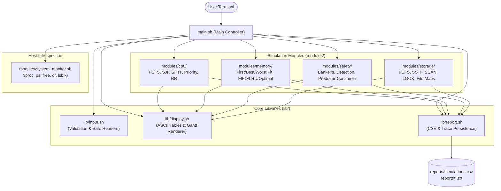

# 🖥️ OS Resource Management & Simulation Suite

<div align="center">

[](https://www.gnu.org/software/bash/)
[](https://ubuntu.com/wsl)
[](./tests/test_runner.sh)
[](#-system-architecture)
[](LICENSE)

**An enterprise-grade, interactive terminal-based Operating Systems simulation engine and live Linux telemetry toolkit.**  
*Combines rigorous mathematical models of fundamental OS algorithms with real-time host inspection.*

[Explore Features](#-feature-matrix) • [Quick Start](#-quick-start) • [Architecture](#-system-architecture) • [Team Roles](#-team-workstream-distribution) • [Viva Guide](#-viva-voce--academic-defense)

</div>

---

## 📌 Table of Contents

- [Overview](#-overview)
- [Feature Matrix](#-feature-matrix)
  - [1. Process Management & CPU Scheduling](#1-process-management--cpu-scheduling)
  - [2. Memory Management & Virtual Memory](#2-memory-management--virtual-memory)
  - [3. Deadlocks & Process Synchronization](#3-deadlocks--process-synchronization)
  - [4. Disk Head Scheduling & File Allocation](#4-disk-head-scheduling--file-allocation)
  - [5. Live Linux Host System Monitor](#5-live-linux-host-system-monitor)
  - [6. Comparative Benchmarking & Reporting](#6-comparative-benchmarking--reporting)
- [System Architecture](#-system-architecture)
- [Project Directory Structure](#-project-directory-structure)
- [Team Workstream Distribution](#-team-workstream-distribution)
- [Installation & Quick Start](#-installation--quick-start)
  - [Prerequisites](#prerequisites)
  - [Cloning & Running](#cloning--running)
  - [WSL / Windows Instructions](#wsl--windows-environment-note)
- [Interactive CLI Walkthrough & Sample Outputs](#-interactive-cli-walkthrough--sample-outputs)
- [Automated Testing & Acceptance Criteria](#-automated-testing--acceptance-criteria)
- [Viva Voce & Academic Defense](#-viva-voce--academic-defense)
- [Design Highlights & Engineering Principles](#-design-highlights--engineering-principles)
- [License & Authors](#-license--authors)

---

## 📖 Overview

Operating Systems concepts are often taught through isolated textbook problems, making it challenging for students and engineers to visualize how scheduling choices, memory policies, synchronization barriers, and disk seeks interact.

The **OS Resource Management & Simulation Suite** solves this by delivering:
1. **Interactive Simulation Engine**: Mathematically accurate models for all major OS algorithms with dynamic ASCII Gantt charts, step-by-step frame traces, allocation grids, and side-by-side performance comparisons.
2. **Real-time Host Telemetry**: A safe, non-root inspection suite querying the host's actual CPU, process tables, RAM utilization, filesystem mountpoints, and block devices via `/proc` and Linux core utilities.
3. **Automated Verification Harness**: A built-in test runner validating 19 textbook test cases with zero external dependencies.
4. **Audit Logging**: Structured CSV records and timestamped execution logs for academic evaluation and reporting.

---

## 🚀 Feature Matrix

```
                      OS RESOURCE MANAGEMENT & SIMULATION SUITE
                                      (main.sh)
                                          │
    ┌─────────────────┬───────────────────┼───────────────────┬─────────────────┐
    ▼                 ▼                   ▼                   ▼                 ▼
 Module 1          Module 2            Module 3            Module 4          Module 5
CPU SCHEDULING      MEMORY             DEADLOCKS            STORAGE        LIVE MONITOR
 • FCFS            • First Fit         • Banker's Avoid    • FCFS            • CPU & Loads
 • SJF (Non-pre)   • Best Fit          • Matrix Detection  • SSTF            • RAM & Swap
 • SRTF (Preemp)   • Worst Fit         • Producer-Consumer • SCAN (Elevator) • Disk & Mounts
 • Priority        • FIFO Paging       • Mutex & Semaphores• C-SCAN          • Block Devices
 • Round Robin     • LRU Paging        • 4 Coffman Cond.   • LOOK            • Process Tree
 • Gantt Charts    • Optimal (MIN)                         • File Alloc Map
```

### 1. Process Management & CPU Scheduling
* **Algorithms Implemented**:
  * **FCFS (First-Come First-Served)**: Order-of-arrival scheduling preserving FIFO order with idle-interval detection.
  * **SJF (Shortest Job First)**: Non-preemptive scheduling dispatching the smallest available burst time.
  * **SRTF (Shortest Remaining Time First)**: Preemptive scheduling re-evaluating every time slice; coalesces adjacent process execution blocks for clean visualization.
  * **Priority Scheduling**: Supports both **Preemptive** and **Non-preemptive** modes; strictly adheres to UNIX convention (lower numeric integer = higher scheduling priority).
  * **Round Robin (RR)**: Time-sliced scheduling using an active ready queue; accurately handles process arrival at exact quantum expiration boundaries.
* **Outputs**:
  * Auto-generated **dynamic ASCII Gantt chart** with explicit `[IDLE]` gap markers.
  * Formatted timing metrics table: Completion Time ($CT$), Turnaround Time ($TAT = CT - AT$), Waiting Time ($WT = TAT - BT$), Response Time ($RT = \text{First Start} - AT$), and respective averages.
  * **Side-by-Side Comparative Benchmark**: Evaluates all 5 algorithms on identical process workloads.

### 2. Memory Management & Virtual Memory
* **Contiguous Partition Allocation**:
  * **First Fit**: Allocates the first free block with sufficient capacity.
  * **Best Fit**: Allocates the smallest suitable block to minimize leftover space.
  * **Worst Fit**: Allocates the largest available block to retain substantial remaining chunks.
  * Supports both **Fixed Partitioning** (reports internal fragmentation) and **Variable Partitioning** (reports external fragmentation potential).
* **Virtual Memory Page Replacement**:
  * **FIFO (First-In First-Out)**: Evicts pages in strictly chronological order.
  * **LRU (Least Recently Used)**: Tracks per-page reference timestamps to evict the stalest resident page.
  * **Optimal (Belady's MIN)**: Inspects future references to evict the page unneeded for the longest duration (theoretical lower bound).
* **Outputs**:
  * Aligned step-by-step frame matrix tracking frame states, `HIT` / `FAULT` indicators, total page faults, and fault rate percentages ($\%$).

### 3. Deadlocks & Process Synchronization
* **Banker's Safety Algorithm (Avoidance)**:
  * Dynamic vector/matrix inputs: Available ($1 \times R$), Allocation ($P \times R$), Max Demand ($P \times R$).
  * Automated calculation of Need Matrix ($\text{Need}_{ij} = \text{Max}_{ij} - \text{Alloc}_{ij}$).
  * Step-by-step Work vector expansion; discovers and outputs guaranteed Safe Execution Sequences or isolates deadlocked sets.
* **Deadlock Detection Routine**:
  * Multiple-instance resource model utilizing Allocation and Current Request matrices.
  * Distinct from avoidance: detects circular waiting dependencies in already-allocated system states.
* **Process Synchronization Simulation**:
  * Interactive **Bounded-Buffer Producer-Consumer** demonstration.
  * Visualizes counting semaphores (`empty`, `full`) and binary mutual exclusion lock (`mutex`).
  * Live buffer display (`[Item1] [Item2] [EMPTY]...`).
  * Interactive educational review of the **4 Coffman Conditions** (Mutual Exclusion, Hold and Wait, No Preemption, Circular Wait).

### 4. Disk Head Scheduling & File Allocation
* **Disk Scheduling Policies**:
  * **FCFS**: Straightforward FIFO queue servicing.
  * **SSTF (Shortest Seek Time First)**: Selects track closest to current cylinder head.
  * **SCAN (Elevator)**: Moves toward outer limit (0 or Max Cylinder), reverses, and sweeps back.
  * **C-SCAN (Circular SCAN)**: Unidirectional sweep, wraps directly to opposite boundary, and resumes.
  * **LOOK**: Bidirectional sweep reversing at the last pending request without traveling to unused physical boundaries.
* **Outputs**:
  * Step-by-step seek sequence ($H_0 \to H_1 \to H_2 \dots$), per-hop distance calculations ($|H_i - H_{i-1}|$), total head travel, and average seek time.
* **File Allocation Simulation**:
  * **Contiguous Allocation**: Start block + continuous run; detects and highlights external fragmentation failures when fragmented free space exists.
  * **Linked Allocation**: Linked block chains; eliminates external fragmentation and illustrates pointer metadata overhead.
  * **Indexed Allocation**: Dedicated index blocks pointing to data blocks; models direct-access indexing.
  * Interactive 32-block visual disk map with file allocation table and file deletion capabilities.

### 5. Live Linux Host System Monitor
* **Safe Read-Only Telemetry**:
  * Host Uptime, Load Averages, and Core Counts via `/proc/uptime` and `/proc/cpuinfo`.
  * Physical RAM and Swap usage via `free -h` and `/proc/meminfo`.
  * Filesystem partitions, mountpoints, and block devices via `df -h` and `lsblk`.
  * Top process inspectors (Top 15 CPU consumers, Top 15 Memory consumers, name filter).
  * Protected process termination utility: forbids targeting PID 1 or self, requiring explicit double confirmation.

### 6. Comparative Benchmarking & Reporting
* **Universal CSV Schema**: Automatically appends every simulation run to `reports/simulations.csv`:
  ```csv
  timestamp,module,algorithm,input_summary,result_summary,notes
  ```
* **Detailed Execution Traces**: Writes human-readable step-by-step audit logs to `reports/YYYYMMDD_HHMMSS_<module>_<algo>.txt`.

---

## 🏗️ System Architecture



---

## 📁 Project Directory Structure

```text
OS-Resource-Management/
├── main.sh                       # Top-level interactive TUI menu
├── config.sh                     # Color constants, paths, default thresholds
├── lib/
│   ├── input.sh                  # Robust sanitization (non-negative, range, integer checks)
│   ├── display.sh                # ASCII banner, divider, and Gantt chart renderer
│   └── report.sh                 # CSV appender, trace file generator, report viewer
├── modules/
│   ├── cpu/                      # Module 1: CPU Scheduling
│   │   ├── menu.sh               # CPU submenu & side-by-side benchmark runner
│   │   ├── fcfs.sh               # First-Come First-Served implementation
│   │   ├── sjf.sh                # Non-preemptive Shortest Job First
│   │   ├── srtf.sh               # Preemptive Shortest Remaining Time First
│   │   ├── priority.sh           # Priority (Non-preemptive & Preemptive modes)
│   │   └── round_robin.sh        # Round Robin with queue & boundary handling
│   ├── memory/                   # Module 2: Memory & Virtual Memory
│   │   ├── menu.sh               # Memory submenu & allocation benchmarks
│   │   ├── allocation.sh         # First Fit, Best Fit, Worst Fit partition allocation
│   │   └── paging.sh             # FIFO, LRU, Optimal page replacement
│   ├── safety/                   # Module 3: Deadlocks & Synchronization
│   │   ├── menu.sh               # Deadlocks submenu
│   │   ├── banker.sh             # Banker's Safety Algorithm & sequence finder
│   │   ├── deadlock.sh           # Matrix-based Deadlock Detection routine
│   │   └── synchronization.sh    # Bounded-Buffer Producer-Consumer & Coffman theory
│   ├── storage/                  # Module 4: Disk & Storage
│   │   ├── menu.sh               # Storage submenu
│   │   ├── disk.sh               # FCFS, SSTF, SCAN, C-SCAN, LOOK seek movement
│   │   └── file_allocation.sh    # Contiguous, Linked & Indexed file simulators
│   └── system_monitor.sh         # Module 5: Read-only live host monitor
├── tests/
│   └── test_runner.sh            # Automated verification test suite (19 test cases)
├── reports/                      # Auto-generated CSV files and detailed text traces
├── docs/
│   ├── ARCHITECTURE.md           # Formal architectural blueprint & module contracts
│   └── VIVA_PREPARATION.md       # 15+ Viva questions, talking points, and derivations
└── README.md                     # Comprehensive project documentation
```

---

## 👥 Team Workstream Distribution

To ensure genuine, verifiable academic collaboration, the codebase is partitioned into four equal workstreams:

| Workstream | Module Ownership | Core Deliverables & Definition of Done |
|---|---|---|
| **Member 1** | **Process & CPU Scheduling** (`modules/cpu/`) | - Five scheduling algorithms (FCFS, SJF, SRTF, Priority, Round Robin)<br>- Dynamic ASCII Gantt chart renderer<br>- CT, TAT, WT, RT calculation table<br>- Idle intervals & arrival tie handling |
| **Member 2** | **Memory & Virtual Memory** (`modules/memory/`) | - Three contiguous allocation policies (First Fit, Best Fit, Worst Fit)<br>- Fixed vs. Variable partitioning fragmentation analysis<br>- FIFO, LRU, and Optimal page replacement with frame trace matrices<br>- Fault rate calculation |
| **Member 3** | **Deadlocks & Synchronization** (`modules/safety/`) | - Banker's Safety Algorithm with Need matrix calculation and Safe Sequence finder<br>- Deadlock Detection algorithm on multiple-instance resource matrices<br>- Bounded-buffer producer-consumer event simulator with semaphores & mutex<br>- Coffman condition analysis |
| **Member 4** | **Storage & Integration Lead** (`modules/storage/`, `lib/`, `main.sh`) | - Five disk scheduling algorithms (FCFS, SSTF, SCAN, C-SCAN, LOOK)<br>- Contiguous, Linked, and Indexed file allocation simulators with 32-block disk map<br>- Live Linux host system monitor (`modules/system_monitor.sh`)<br>- Shared libraries (`lib/`), main menu integration, and automated test suite |

---

## 💻 Installation & Quick Start

### Prerequisites
- **Bash 4.4+** (Ubuntu/Debian, Fedora, Arch, WSL, macOS, or Git Bash)
- Standard core utilities: `awk`, `sed`, `grep`, `column`, `date` (pre-installed on virtually all Linux distributions)

### Cloning & Running
```bash
# 1. Clone the repository
git clone https://github.com/tejapampana09/OS-Resource-Management.git
cd OS-Resource-Management

# 2. Grant execute permissions
chmod +x main.sh config.sh lib/*.sh modules/**/*.sh modules/*.sh tests/*.sh

# 3. Launch the interactive application
./main.sh
```

### ⚡ WSL / Windows Environment Note
If you are developing on Windows with WSL, navigate to your project mountpoint in your WSL terminal before running:
```bash
cd "/mnt/c/Users/<YourUsername>/path/to/OS-Resource-Management"
./main.sh
```

---

## 🖥️ Interactive CLI Walkthrough & Sample Outputs

### 1. CPU Scheduling: ASCII Gantt Chart & Timing Table
```text
Execution Results (FCFS)
PID      Arrival (AT) Burst (BT) Completion (CT) Turnaround (TAT) Waiting (WT)  Response (RT) 
-----------------------------------------------------------------------------------------------
P1       0            5          5               5                0             0             
P2       1            3          8               7                4             4             
P3       2            8          16              14               6             6             
P4       3            6          22              19               13            13            
-----------------------------------------------------------------------------------------------
Average Turnaround Time (TAT): 11.25
Average Waiting Time    (WT) : 5.75
Average Response Time   (RT) : 5.75

Execution Gantt Chart:
  +-------+-------+--------+--------+
  | P1    | P2    | P3     | P4     |
  +-------+-------+--------+--------+
  0       5       8        16       22
```

### 2. Page Replacement: Step-by-Step Frame Trace
```text
Page Replacement Trace (FIFO - 3 Frames)
Step   | Ref Page | Frames    | Status  
--------------------------------------------
1      | 7        | 7 - -     | FAULT   
2      | 0        | 7 0 -     | FAULT   
3      | 1        | 7 0 1     | FAULT   
4      | 2        | 2 0 1     | FAULT   
5      | 0        | 2 0 1     | HIT     
6      | 3        | 2 3 1     | FAULT   
7      | 0        | 2 3 0     | FAULT   
--------------------------------------------
Total References : 20
Page Hits        : 5
Page Faults      : 15
Fault Rate       : 75.00%
```

### 3. Banker's Algorithm: Safe Sequence Evaluation
```text
Safety Evaluation Result
Step 1: P2 can finish. Work before: [3 3 2]. Work after release: [5 3 2]
Step 2: P4 can finish. Work before: [5 3 2]. Work after release: [7 4 3]
Step 3: P1 can finish. Work before: [7 4 3]. Work after release: [7 5 3]
Step 4: P3 can finish. Work before: [7 5 3]. Work after release: [10 5 5]
Step 5: P5 can finish. Work before: [10 5 5]. Work after release: [10 5 7]

[SAFE STATE] The system is in a safe state.
Safe Sequence: P2 -> P4 -> P1 -> P3 -> P5
```

### 4. Disk Head Travel Trace (SCAN Algorithm)
```text
Disk Head Movement (SCAN)
Initial Head: 53 | Direction: Up | Max Cylinder: 199

Head Travel Sequence:
  53 -> 65 -> 67 -> 98 -> 122 -> 124 -> 183 -> 199 -> 37 -> 14

Step   | From Cylinder    | To Cylinder      | Seek Distance   
-----------------------------------------------------------------
1      | 53               | 65               | 12              
2      | 65               | 67               | 2               
3      | 67               | 98               | 31              
4      | 98               | 122              | 24              
5      | 122              | 124              | 2               
6      | 124              | 183              | 59              
7      | 183              | 199              | 16              
8      | 199              | 37               | 162             
9      | 37               | 14               | 23              
-----------------------------------------------------------------
Total Head Movement: 331 cylinders
Average Seek Time  : 41.38 cylinders/request
```

---

## 🧪 Automated Testing & Acceptance Criteria

The test runner [`tests/test_runner.sh`](./tests/test_runner.sh) executes 19 automated acceptance tests covering textbook scenarios and boundary edge cases:

```bash
bash tests/test_runner.sh
```

### Test Results Matrix

| Test ID | Module | Scenario / Edge Case | Expected Result | Status |
|:---:|:---|:---|:---:|:---:|
| `TC-01` | **CPU** | FCFS with Idle Interval (P1=3, P2 arrives at t=5) | Avg WT = `0.00` | ✅ PASS |
| `TC-02` | **CPU** | FCFS with Idle Interval Turnaround Time | Avg TAT = `2.50` | ✅ PASS |
| `TC-03` | **CPU** | Non-preemptive SJF Waiting Time | Avg WT = `2.00` | ✅ PASS |
| `TC-04` | **CPU** | Non-preemptive SJF Turnaround Time | Avg TAT = `4.33` | ✅ PASS |
| `TC-05` | **CPU** | Preemptive SRTF Mid-burst Preemption | Avg WT = `2.00` | ✅ PASS |
| `TC-06` | **CPU** | Preemptive SRTF Turnaround Time | Avg TAT = `8.00` | ✅ PASS |
| `TC-07` | **CPU** | Round Robin Slice-Boundary Arrival Queueing | Avg WT = `1.00` | ✅ PASS |
| `TC-08` | **CPU** | Round Robin Turnaround Time | Avg TAT = `4.00` | ✅ PASS |
| `TC-09` | **Memory** | FIFO Page Replacement (3 Frames, 20 References) | `15` Faults | ✅ PASS |
| `TC-10` | **Memory** | LRU Page Replacement (3 Frames, 20 References) | `12` Faults | ✅ PASS |
| `TC-11` | **Memory** | Optimal Page Replacement (3 Frames, 20 References) | `9` Faults | ✅ PASS |
| `TC-12` | **Memory** | Best Fit Contiguous Partition Allocation | `4/4` Allocated | ✅ PASS |
| `TC-13` | **Safety** | Banker's Algorithm on Silberschatz Safe State | State = `SAFE` | ✅ PASS |
| `TC-14` | **Safety** | Banker's Algorithm on Deadlock-prone Matrix | State = `UNSAFE` | ✅ PASS |
| `TC-15` | **Safety** | Deadlock Detection Multiple-Instance Cycle | State = `DEADLOCKED` | ✅ PASS |
| `TC-16` | **Storage** | FCFS Disk Scheduling (Head=53, 8 Requests) | `640` Cylinders | ✅ PASS |
| `TC-17` | **Storage** | SSTF Disk Scheduling (Head=53, 8 Requests) | `236` Cylinders | ✅ PASS |
| `TC-18` | **Storage** | SCAN Disk Scheduling (Head=53, Direction=Up) | `331` Cylinders | ✅ PASS |
| `TC-19` | **Storage** | LOOK Disk Scheduling (Head=53, Reversing at 183) | `299` Cylinders | ✅ PASS |

**Result: 19 Passed, 0 Failed (100% Pass Rate)**

---

## 🎓 Viva Voce & Academic Defense

*Extracted from [`docs/VIVA_PREPARATION.md`](./docs/VIVA_PREPARATION.md):*

### 1. What is the fundamental difference between a simulator and a real OS kernel?
> A **simulator** is an educational, user-space program that models algorithm logic mathematically using arrays and timers. It does not touch hardware. An **OS kernel** runs in supervisor mode (Ring 0) and directly programs the hardware MMU, APIC timers, disk controllers, and interrupt vectors.

### 2. Why can SJF reduce average waiting time, and what is its main drawback?
> By greedily selecting the shortest burst, shorter processes finish and exit early, which drastically shrinks queue lengths and reduces the waiting time experienced by all subsequent processes. Its main drawback is **starvation** (indefinite postponement) of long-burst jobs if a stream of short jobs continues arriving.

### 3. What is Belady's Anomaly, and which algorithms avoid it?
> **Belady's Anomaly** is the phenomenon where adding physical page frames causes the page fault rate to *increase* rather than decrease. FIFO suffers from Belady's Anomaly because it ignores reference frequency and recency. Stack algorithms (like **LRU** and **Optimal**) are mathematically proven never to experience Belady's Anomaly.

### 4. How does SCAN differ from LOOK in disk scheduling?
> Both move in one direction servicing requests. However, **SCAN (Elevator)** travels all the way to the **physical disk platter boundary** (cylinder 0 or max cylinder) before reversing. **LOOK** reverses as soon as it services the **last pending request** in that direction, saving unnecessary cylinder travel.

### 5. Why are the 4 Coffman conditions essential in deadlock handling?
> Deadlock cannot exist unless all 4 conditions hold simultaneously:
> 1. *Mutual Exclusion*
> 2. *Hold and Wait*
> 3. *No Preemption*
> 4. *Circular Wait*
>
> Deadlock **prevention** works by systematically invalidating at least one condition (e.g., establishing a global ordering of resource acquisitions to eliminate circular wait).

---

## 💡 Design Highlights & Engineering Principles

- **Zero External Compilers**: Runs out-of-the-box on standard Bash without requiring GCC, Python, or Node.js.
- **Fail-Safe Input Handling**: Loops until valid input is received, rejecting negative numbers, non-integers, empty strings, and out-of-range bounds without crashing.
- **Strict Variable Scoping**: Functions utilize `local` variables and quote all array expansions to prevent word splitting and namespace collisions.
- **Portable Host Telemetry**: Checks utility availability before running commands; gracefully falls back to `/proc` when tools like `free` or `lsblk` are omitted in lightweight container environments.
- **Non-Destructive Operations**: Prohibits killing system critical processes (PID 1, init, or the current shell) and enforces double-confirmation guards.

---

## 📄 License & Authors

Distributed under the **MIT License**. See `LICENSE` for details.

### Authors & Core Contributors
- **Teja Pampana** ([@tejapampana09](https://github.com/tejapampana09))
- **Team Collaborators** (Modules 1, 2, 3 & 4 Workstream Owners)

---

<div align="center">
  <sub>Built with ❤️ for Operating Systems Computer Science coursework. Star ⭐ this repository if it helped your understanding!</sub>
</div>
